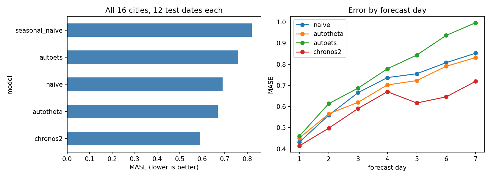
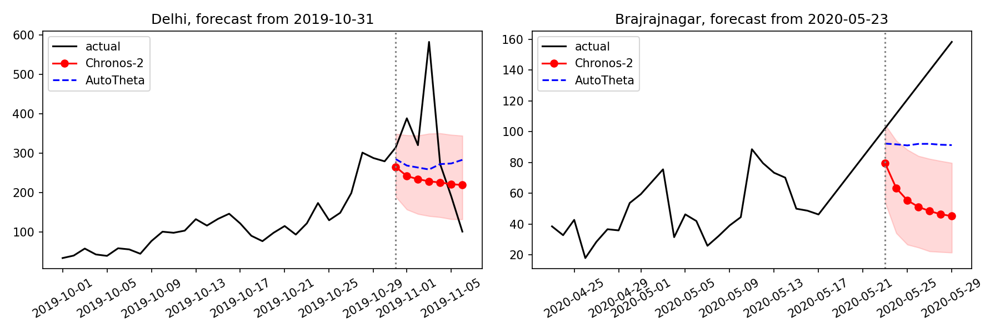

# Does a pretrained forecasting model beat standard baselines on Indian air-quality data?

A small benchmark of **Chronos-2** (Amazon's pretrained time-series model, used zero-shot with no training on this data) against standard forecasting methods, on daily PM2.5 data from 16 Indian cities.

## Main result

| Model | MAE | MASE (lower is better) |
|---|---|---|
| **Chronos-2** | 16.05 | **0.59** |
| AutoTheta | 18.72 | 0.67 |
| Naive ("same as today") | 19.20 | 0.69 |
| AutoETS | 21.10 | 0.76 |
| Seasonal naive ("same as last week") | 22.77 | 0.82 |

- Chronos-2 beat the best statistical baseline (AutoTheta) by 0.076 MASE (95% bootstrap range over cities: 0.040 to 0.114).
- It beat all four baselines in **13 of 16 cities**.
- The gain was concentrated in the post-monsoon and winter test windows (post-monsoon MASE 0.86 vs 1.07 for naive; winter 0.80 vs 0.92). There was no gain in monsoon and summer windows.
- At a 1-day horizon the gain is small (MASE 0.41 vs 0.43 for naive). It tends to be larger at 5-7 days (0.62-0.72 vs 0.72-0.85 for the best baseline).
- Chronos-2's 10%-90% prediction interval contained the true value 77% of the time (nominal 80%).
- The worst forecasts for all models clustered at the end of October 2019, shortly after Diwali, so that period is hard for every method, not just Chronos-2.

## Data

- Kaggle: "Air Quality Data in India (2015-2020)" (`city_day.csv`). Download it yourself from Kaggle and place it in the repo folder.
- 26 cities to start. 4 were dropped for more than 20% missing PM2.5 (Ahmedabad, Mumbai, Jorapokhar, Shillong), and 6 for fewer than 500 days of history (Aizawl, Bhopal, Chandigarh, Coimbatore, Ernakulam, Kochi). **16 cities remain.**
- Remaining gaps were filled by linear interpolation.

## Method

- **Rolling-origin backtesting:** 12 forecast dates per city, 30 days apart over roughly the last year of the data. From each date, forecast the next 7 days. Every model saw only data before the forecast date.
- **Models:** naive, seasonal naive (7-day), AutoETS and AutoTheta (statsforecast, fitted on the last 900 days), and Chronos-2 (`amazon/chronos-2`, zero-shot).
- **Metric:** MASE, which divides each error by the city's normal week-to-week change, so cities with high and low pollution are comparable.
- **Significance:** bootstrap over the 16 cities.

## Files

| File | What it is |
|---|---|
| `notebook.ipynb` | All the code, run top to bottom |
| `results_all.csv` | Error for every city, date and model |
| `forecasts.csv` | Every individual forecast (for plots and per-day analysis) |
| `results_table.csv` | The summary table above |
| `main_results.png`, `failure_cases.png` | Figures |

## How to reproduce

1. Download `city_day.csv` from Kaggle.
2. Open `notebook.ipynb` in Google Colab with a T4 GPU.
3. Upload `city_day.csv`, then use *Runtime → Run all*.
4. Install dependencies with `pip install -r requirements.txt`.

## Failure cases

[Write 2-3 sentences after you look at the plot. For example: "Forecasts from 31 Oct 2019 missed the post-Diwali rise for all models." For Brajrajnagar on 23 May 2020, only write that Chronos-2 was far off if the actual values were real and not interpolated.]

## Limitations

- Only one foundation model, used zero-shot. No fine-tuning and no other models such as TimesFM.
- One test year, so each season appears once and is mixed up with that year's events (Diwali, the COVID lockdown from March 2020).
- Chronos-2's training data may overlap with these public datasets. I could not check this.
- Interpolated values were used in both fitting and scoring.
- AutoARIMA was excluded because of free-tier compute limits.
- Only Chronos-2 gave prediction intervals, so calibration was not compared across models.
- Only daily PM2.5 with a 7-day horizon.
- The bootstrap treats cities as independent, but nearby cities (for example Delhi and Gurugram) are probably correlated.

## Model credits

Chronos-2: Ansari et al., "Chronos-2: From Univariate to Universal Forecasting" (arXiv 2510.15821). Baselines: `statsforecast`.
